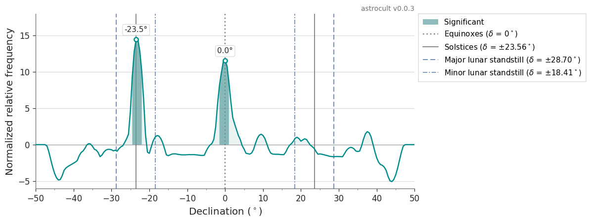
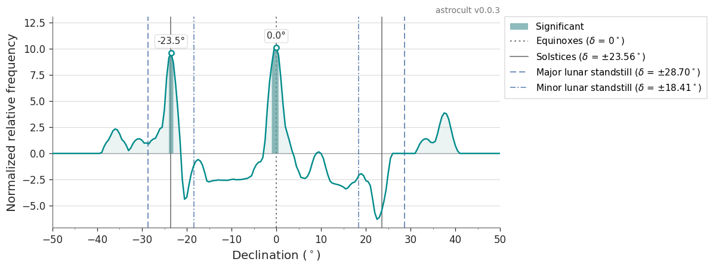
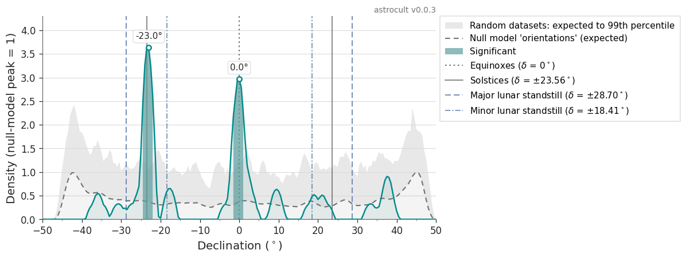
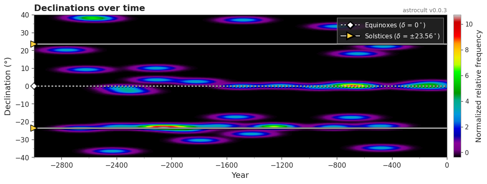
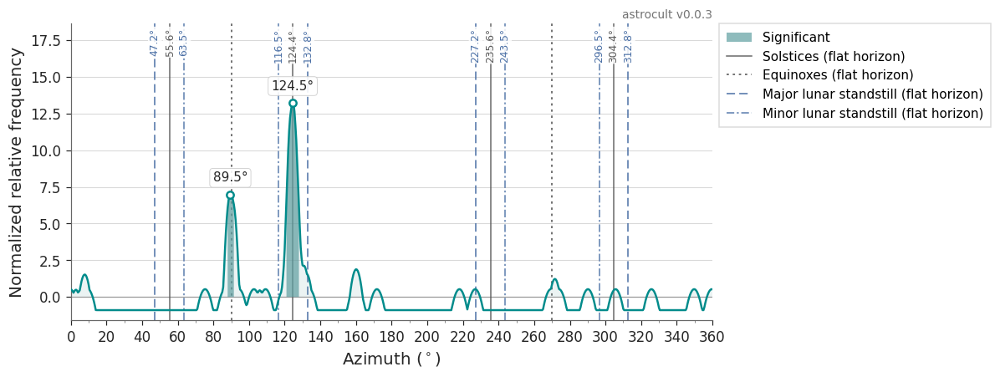
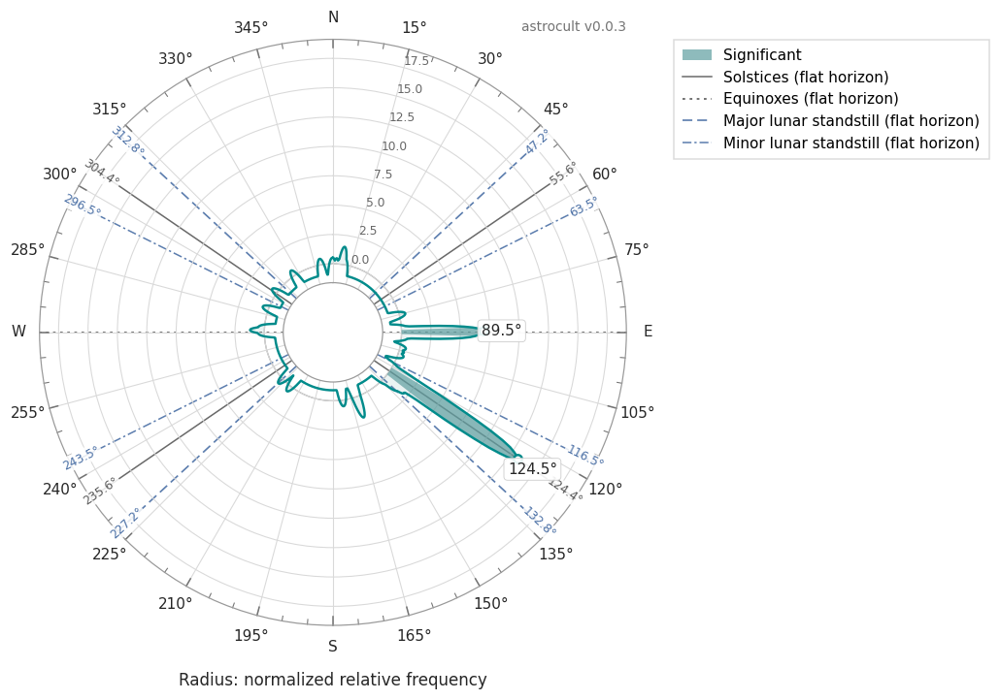
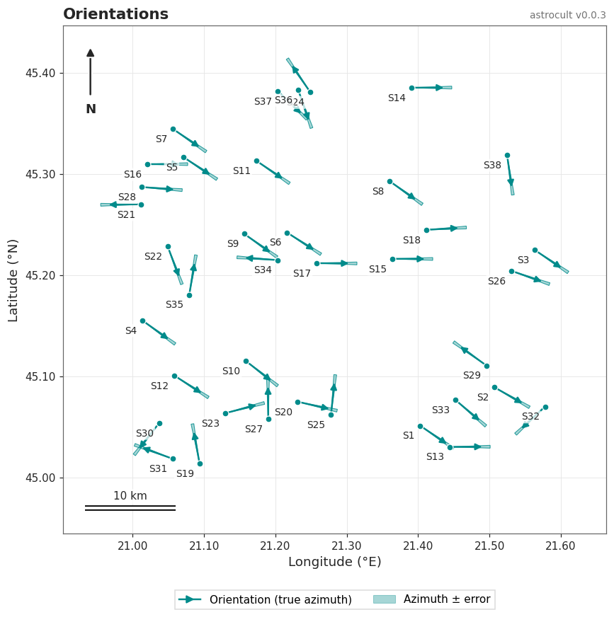
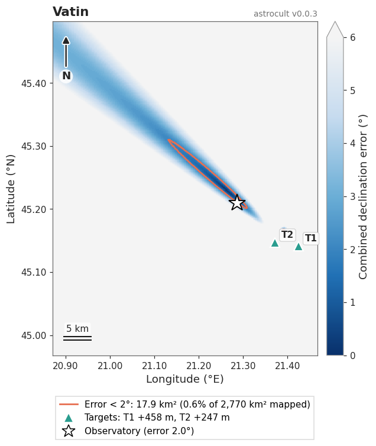

# AstroCult

Is a python package providing basic functionality for archaeoastronomy analysis. It can:
- perform statistical analysis of orientations in the form of curvigrams (adaptive kernel densities) of azimuths and declinations, with significance tested against realistic null models (random orientations, or the Sun on random days);
- plot orientations on a map (arrows with their azimuth errors) and as compass-style polar curvigrams;
- compute the Sun's declination at sunrise for every day of a historical (Julian) year, using JPL ephemerides;
- convert between Julian and Gregorian dates for any year from 4713 BCE;
- generate the location error heatmap for one or more horizon landmarks given an intended alignment, including the Earth's curvature and, optionally, the visibility of distant landmarks, and compute how special a location is (share and area in km² of the map where the alignments work);
- retrieve the magnetic declination from NOAA to correct compass readings;
- perform simple machine learning tasks such as clustering together similar declinations/azimuths, assess which features are most important from a dataset.

## Installation

```
pip install astrocult
```

AstroCult requires Python 3.12 or newer. The ephemeris files used for solar declinations are downloaded automatically by skyfield the first time they are needed (see [Solar declinations for a year](#solar-declinations-for-a-year)).

## Conventions

- Angles are in degrees. Latitudes and longitudes are positive north and east.
- Azimuths are true azimuths measured from north through east (0-360°). Correct magnetic compass readings with the magnetic declination first (see [Getting the magnetic declination of a location](#getting-the-magnetic-declination-of-a-location)).
- Years are Julian calendar years in astronomical numbering: year 0 is 1 BCE, year -1 is 2 BCE, and so on.
- Bin widths for curvigrams are interpreted as 2σ; twice the measurement error of each point is recommended.
- All plots return the matplotlib figure and axes, accept `ax=` to draw into your own figure, `savepath=` to save at 300 dpi and `show=False` to skip `plt.show()`. They carry an "astrocult v<version>" label.

## Usage examples

Import the modules:

```
import numpy as np
import pandas as pd
from astrocult import Azimuth, Declination, Altitude, GeoUtils, JulianHelper, Clustering
```

### Declination functions

Get a reference to our Declination object:

```
dec = Declination.Declination()
```

Compute the declination for an orientation seen from a latitude of 45 N: azimuth 125° over a horizon at 0.5° altitude. Note the argument order `calc_decl(lat, alt, az)`:

```
print(dec.calc_decl(45, 0.5, 125))
```

Compute the declination error for the same orientation. It can be used to account for the uncertainty in the orientation. Note the argument order `err_decl(lat, az, alt)`, different from `calc_decl`; keyword arguments avoid mix-ups:

```
print(dec.err_decl(lat=45, az=125, alt=0.5, err_az=0.5, err_alt=0.5))
```

#### Declination curvigrams

Plot the declination curvigram of a set of orientations measured around 45 N, each with its own bin width (twice its declination error):

```
rng = np.random.default_rng(1)
declinations = np.r_[rng.normal(-23.5, 1, 12), rng.normal(0, 1, 8), rng.uniform(-40, 40, 20)]
binwidths = np.full(declinations.size, 2.0)

fig, ax, grid, density, curve, info = dec.plot_decl_adaptive(declinations, 45, binwidths, null_iterations=1000)
print("Significant peaks at:", [p["angle"] for p in info["peaks_significant"]])
```



The curve shows how much more frequent each declination is than expected under a null model, in units of the null model's typical variation. Regions that pass the significance test (99th percentile of the highest peaks of random datasets) are filled in a strong colour and their peaks are labelled. Use `null_iterations` of at least 1000 for final results.

Reference lines mark the equinoxes (dotted), the solstices (solid) and the Moon's limits at the major (dashed) and minor (dash-dotted) standstills, about ±28.7° and ±18.4° (`draw_lunar_lines=False` hides the lunar ones). The x-axis is trimmed to the outermost structures ±10° (`xpad_deg`); pass `xlim=(-90, 90)` for the full range. Trimming only changes the view, not the results. Azimuth plots always show the full 0-360°, and there each solstice and lunar standstill line is labelled with its flat-horizon azimuth.

Three null models are available (`null_model=`):
- `"orientations"` (default): random azimuths converted into declinations at the sites' latitude(s) and horizon altitude(s). This is what structures without astronomical intent would produce. Pass one latitude, or one per site, and optionally the measured horizon altitudes:

```
latitudes = rng.uniform(44.8, 45.2, declinations.size)   # one latitude per site
horizons = rng.uniform(0, 3, declinations.size)          # measured horizon altitude per site
dec.plot_decl_adaptive(declinations, latitudes, binwidths, null_altitudes=horizons, null_iterations=1000)
```

- `"solar"`: the Sun's declination on random days of the year. Use it to ask whether particular dates (solstices, equinoxes, feast days) are preferred among solar orientations:

```
dec.plot_decl_adaptive(declinations, 45, binwidths, null_model="solar", null_iterations=1000)
```



- `"uniform"`: declinations uniform between -90° and 90°, only to reproduce results of earlier versions. It overstates significance, especially far from the equator.

Optional displays: `show_null_model=True` draws the null model's expected curve, `show_null_range=True` a band from that expected curve up to the 99th percentile of random datasets at each position, and `view="density"` shows the data and the null model as densities on one axis, both scaled so that the null model's peak is 1:

```
dec.plot_decl_adaptive(declinations, latitudes, binwidths, null_altitudes=horizons,
                       view="density", show_null_model=True, show_null_range=True)
```



The null model used for the test can also be built directly, e.g. to draw random datasets:

```
sampler = dec.make_null_sampler("orientations", latitude=45, null_altitudes=2.0)
random_declinations = sampler(100, np.random.default_rng(0))
```

#### Solar declinations for a year

Compute the Sun's declination at sunrise for every day of the year 2000 from a latitude of 45 N, longitude of 23 E and elevation of 100 meters:

```
df_dec = dec.calculate_declinations_for_entire_year(2000, 45, 23, 100, write_to_file=False)

print("Declination on January 1:", df_dec.iloc[0]["Sun Declination value on date"])
print("Declination on December 31:", df_dec.iloc[-1]["Sun Declination value on date"])   # row 365: 2000 is a leap year
```

Historical years work too, for any Julian year from -4712 (4713 BCE):

```
df_old = dec.calculate_declinations_for_entire_year(-1500, 45, 23, 100, write_to_file=False)
```

The JPL ephemeris file is chosen automatically: `de421.bsp` (17 MB) for 1900-2049, otherwise `de422.bsp` (623 MB, about 3000 BCE to 3000 CE); for earlier years pass `ephemeris="de441.bsp"` (about 3 GB). Files are downloaded on first use into the working directory; for offline machines download them from https://ssd.jpl.nasa.gov/ftp/eph/planets/bsp/ and place them there. An approximate solar declination for a day of the year is also available without ephemerides:

```
print(dec.solar_declination_approx(171, obliquity_deg=23.9))   # around the June solstice, ~2000 BCE obliquity
```

#### Declinations over time

Plot a density map to explore how declinations changed over time. `bw` is the declination bin width (2σ, e.g. twice the declination error) and `bw_x` the width along the time axis (e.g. twice the dating uncertainty):

```
years = rng.uniform(-3000, 0, declinations.size)
dec.plot_fmap(years, declinations, 2.0, -3000, 0, -40, 40, bw_x=200,
              xlabel="Year", ylabel="Declination (°)", title="Declinations over time")
```



### Azimuth functions

While in practice we prefer declinations, there are cases when azimuths can still be used.

Get a reference to our Azimuth object:

```
az = Azimuth.Azimuth()
```

Compute the azimuth error from successive measurements of a single site (in a single direction). Readings on either side of north are handled correctly:

```
print(az.err_az([124.5, 125, 125.5, 124]))
print(az.err_az([359, 1]))   # 2° apart, not 358°
```

Compute the rising (east) and setting (west) azimuths of a declination, here the June solstice Sun on a flat horizon at 45 N:

```
east, west = az.calc_az(0.0, 45.0, 23.44)
```

Plot the azimuth curvigram for a set of azimuths measured at 45 N with their bin widths (twice the azimuth errors), on a linear axis or as a compass-style circle:

```
azimuths = np.r_[rng.normal(124, 2, 12), rng.normal(90, 2, 6), rng.uniform(0, 360, 20)] % 360
az_binwidths = np.full(azimuths.size, 4.0)

az.plot_az_adaptive(azimuths, 45, az_binwidths, null_iterations=1000)
az.plot_az_adaptive(azimuths, 45, az_binwidths, null_iterations=1000, polar=True)
```





The solstice and equinox reference lines assume a flat horizon; for a site-specific horizon convert the measurements to declinations and use the declination curvigram.

Plot the sites on a map with an arrow along each azimuth and a wedge for its error:

```
site_lat = rng.uniform(45.0, 45.4, azimuths.size)
site_lon = rng.uniform(21.0, 21.6, azimuths.size)
az.plot_orientation_map(site_lat, site_lon, azimuths, errors=2.0,
                        labels=[f"S{i + 1}" for i in range(azimuths.size)], title="Orientations")
```



### Altitude functions

Get a reference to our Altitude object:

```
alt = Altitude.Altitude()
```

Correct a measured (apparent) altitude for atmospheric refraction, which lifts objects near the horizon; the result is the true geometric altitude:

```
print(alt.update_alt_by_atmospheric_refraction(1))
```

Compute the altitude error considering the systematic instrument/reading error and the atmospheric refraction. It can be used to account for the uncertainty in the orientation:

```
print(alt.err_alt(1, err_alt=0.5))
```

### Julian and Gregorian dates

Get a reference to our JulianHelper object:

```
jh = JulianHelper.JulianHelper()
```

Convert a Julian date into the (proleptic) Gregorian date of the same day, and get the difference in days, for any year from 4713 BCE:

```
print(jh.julian_to_gregorian(1582, 10, 4))          # (1582, 10, 14)
print(jh.julian_gregorian_offset_days(1900, 2, 29)) # 13
print(jh.julian_gregorian_offset_days(-500, 6, 21)) # -5 (501 BCE)
```

Estimate the UTC sunrise for a Gregorian date and location:

```
import datetime
print(jh.estimate_sunrise_noaa(datetime.datetime(2024, 6, 21), 45.75, 21.23))
```

### Getting the magnetic declination of a location

Get a reference to our GeoUtils object:

```
gu = GeoUtils.GeoUtils()
```

Retrieve from NOAA the magnetic declination together with its uncertainty. Add it to azimuths taken with a magnetic compass to obtain true azimuths:

```
md, md_unc = gu.get_magnetic_declination(45, 25, 2025, 6, 21)
```

The default model is the World Magnetic Model (2024-2029). For compass readings from older surveys use `model="IGRF"` (1590-2029):

```
md_1950, _ = gu.get_magnetic_declination(45, 25, 1950, 6, 21, model="IGRF")
```

### Error heatmaps and location probability

For a given area we might want to know what is the best place to place an observatory so that the astronomical event is aligned with a given horizon marker. At the same time we might want to calculate the probability of randomly picking a location in the aforementioned area.
The code below shows an example of how this can be done. It also shows how the GeoUtils can be used to compute the altitude of the horizon from a certain point:

First we need the location of our observatory:

```
vatinLat = 45.210
vatinLon = 21.287
```

Second we need to set our target declinations, in this case the moon and sun at winter solstice:

```
sunDec = -24.1552
moonDec = -30.1094

targetAstroBodies = []
targetAstroBodies.append(['sun', sunDec])
targetAstroBodies.append(['moon', moonDec])
```

We also provide more information such as the latitude, longitude, altitude in degrees and distance from the observatory in meters:

```
# winter solstice point 6a
target1Lat = 45.141687
target1Lon = 21.425
target1Alt = 1.9
dist1FromVatin = 13380

# southern lunastice point 4a
target2Lat = 45.147294
target2Lon = 21.371814
target2Alt = 1.42
dist2FromVatin = 9678
```

Finally, initialize some classes:

```
gu = GeoUtils.GeoUtils()
dec = Declination.Declination()
```

Now it is time to actually start our analysis:

We compute the azimuth and declination given by the direction from the observatory to each of the 2 targets. The declination is computed for the observatory's latitude:

```
az1 = gu.get_bearing(vatinLat, target1Lat, vatinLon, target1Lon)
dec1 = dec.calc_decl(vatinLat, target1Alt, az1)

az2 = gu.get_bearing(vatinLat, target2Lat, vatinLon, target2Lon)
dec2 = dec.calc_decl(vatinLat, target2Alt, az2)
```

Note the argument order of `get_bearing(lat1, lat2, lon1, lon2)`. It returns azimuths between -180° and 180°, which `calc_decl` accepts directly.

Optionally, we can compute the error between the real declinations and those provided by our observatory. The error is a quadratic sum as both need to happen simultaneously:

```
import math
vatinError = math.sqrt((sunDec-dec1) * (sunDec-dec1) + (moonDec-dec2) * (moonDec-dec2))
```

We also compute the 2 targets' heights in meters above the observer's eye level from their altitude and distance. The Earth's curvature is taken into account (pass `curvature=False` for the flat-Earth value):

```
target1HeightMeters = gu.horizon_height_meters(dist1FromVatin, target1Alt)
target2HeightMeters = gu.horizon_height_meters(dist2FromVatin, target2Alt)
```

Now we can construct the heatmap by providing a geographical bounding box:

```
latRange = np.round(np.arange(44.968, 45.500, 0.002), 6)
lonRange = np.round(np.arange(20.871, 21.468, 0.002), 6)

targetGeoLocations = []
targetGeoLocations.append([target1Lat, target1Lon, target1HeightMeters])
targetGeoLocations.append([target2Lat, target2Lon, target2HeightMeters])

coordsRange = [latRange, lonRange]
```

Finally we can compute the heatmap and the probability of picking our observatory location by chance. Any number of targets (one or more) can be used, each paired with one astronomical body. The whole grid is computed at once, so fine grids are fast:

```
df = gu.compute_error_heatmap(targetGeoLocations, targetAstroBodies, coordsRange)
print("Location probability", gu.compute_location_probability(df, 2))

area_below, area_total = gu.compute_location_area(df, 2)
print(f"Error below 2°: {area_below:.1f} km² of {area_total:.0f} km² mapped")
```

The location probability is the share of the mapped area where the error is below the threshold, so it depends on the extent of the grid: choose and report the extent deliberately.

The errors of the targets can be combined in three ways (`combine=`): `"rss"` (default, the quadratic sum above, which grows with the number of targets), `"rms"` (the typical error per target, comparable between sites with different numbers of targets) or `"max"` (the worst target). Distant targets can also be checked for visibility: with `observer_height_m` (eye height above the terrain in between) positions from which a target is hidden by the Earth's curvature are marked unusable, and with `max_distance_km` positions farther than a chosen limit:

```
df_rms = gu.compute_error_heatmap(targetGeoLocations, targetAstroBodies, coordsRange,
                                  combine="rms", observer_height_m=1.6, max_distance_km=40)
```

Plot the heatmap as a static map, with the area below the threshold outlined and its size in km²:

```
gu.plot_error_map(df, observatory=[vatinLat, vatinLon, vatinError], targetGeoLocations=targetGeoLocations,
                  threshold=2, title="Vatin")
```



Or show it on an interactive topographic web map (opens in the browser); only cells with an error below `filter_threshold` are shown, the best ones brightest:

```
gu.show_heatmap(df, [vatinLat, vatinLon, vatinError], targetGeoLocations, [vatinLat, vatinLon], 11, 4)
```

We can additionally plot the error heatmap histogram:

```
gu.plot_error_heatmap_histogram(df)
```

As well as exporting the heatmap as geojson files that we can later import in GIS viewers:

```
json_heatmap, json_targets = gu.build_geojson_from_heatmap(df, [[vatinLat, vatinLon, vatinError]], targetGeoLocations)
```

### Clustering functions

We first need some data with multiple features (characteristics/properties). The package works with dataframes so we need to convert our data to one.
Clustering is useful when we want to see if certain datapoints (i.e., locations) form distinct groups.

```
data = {'Lat':[45.1, 44.9, 45.2, 44.8],
        'Lon':[23.2, 23.3, 23.1, 23.3],
        'Declination': [20, -21, 19, -18]}

df = pd.DataFrame(data)
```

Initialize the Clustering object:

```
clustering = Clustering.Clustering()
```

Now we can start performing some clustering on data points (grouping of data based on the features). All columns are scaled to [0, 1] first, so each column counts equally: only pass columns that carry real structure.

If we have many features we can reduce them by using Principal Component Analysis. Here we reduce all data to 2 dimensions (features).

```
df_pca, pca_components = clustering.create_PCA(df, 2)
```

We can show the correlation matrix outlying the importance of each original feature in the newly created ones:

```
clustering.show_PCA_correlation_matrix(pca_components)
```

We can cluster together data points. We can use either KMeans or Agglomerative (hierarchical) clustering.

KMeans:

```
# For KMeans we need to choose the number of clusters. It can be estimated with the
# silhouette score (needs at least 3 data points; more give a more reliable answer):
kmeans_optimum_no_clusters = clustering.get_optimal_number_of_kmeans_clusters(df)
kmeans_model, df_kmeans = clustering.create_kmeans_clusters(df, 2)

print(df_kmeans)

clustering.show_clusters(df_kmeans, ['Lat', 'Lon'], kmeans_model)
```

Agglomerative clustering:

```
hierarchical_model, df_hierarchical = clustering.create_hierachical_clusters(df, distance_threshold=0)

print(df_hierarchical)

clustering.show_clusters(df_hierarchical, ['Lat', 'Lon'], hierarchical_model)
```

For hierarchical clusters we can also show the dendrogram, i.e., how clusters relate to each other:

```
clustering.show_dendrogram(hierarchical_model)
```

Azimuths are circular (0° and 360° are the same direction), so ordinary KMeans would split a group of orientations around north. Use circular KMeans instead:

```
df_az = pd.DataFrame({'Azimuth': [355, 2, 5, 358, 120, 118, 123]})
circular_model, df_circular = clustering.create_circular_kmeans_clusters(df_az, 'Azimuth', 2)
print(df_circular)
```

## Running the tests

The test suite uses pytest:

```
pip install pytest
pytest -v tests/
```
